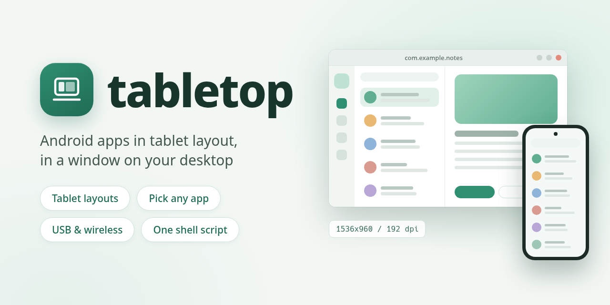

# tabletop



Run your phone's apps in tablet layout, each in its own window on your Linux desktop.

tabletop asks which phone to use and which app to open. It then has
[scrcpy](https://github.com/Genymobile/scrcpy) start that app on a separate virtual display
sized like a tablet. Apps switch to their large-screen layouts (navigation rails, list and
detail side by side), and your phone's own screen stays free.

Tested on a Pixel 9 running Android 17, with scrcpy 5.0.1 on KDE Plasma (Wayland).

## How it works

```
adb devices ──► pick a phone ──► pick an app ──► scrcpy --new-display=1536x960/192
 (USB + wireless)   (zenity)     (launcher apps)          --start-app=<package>
```

- Every ready device is listed, over USB or Wireless debugging. A phone connected both
  ways shows up once, using USB. With only one phone connected, the picker is skipped.
- Phones are listed by codename and serial, e.g. `tokay (52220DLAQ001KK)`.
- The app picker lists packages with a launcher icon, read straight from the package
  manager, so it opens almost instantly. Type in it to search.
- scrcpy opens the app on a new virtual display that resizes along with the window
  (`--flex-display`). It keeps the phone awake while the window is open.

## Requirements

- Linux with `scrcpy` (3.0 or newer; tested with 5.0.1), `adb` (`android-tools`) and `zenity`
- Android 10 or newer, with **Developer options → USB debugging** on. For cordless use, also
  turn on **Wireless debugging** and pair once with `adb pair <ip>:<pairing-port>`.
- Some phone makers' Android versions handle virtual displays less well than Pixels do.

## Install

On Arch Linux, build and install the package with the included PKGBUILD:

```sh
git clone https://github.com/draumaz/tabletop.git
cd tabletop/packaging/arch
makepkg -si
```

Anywhere else, it's a single shell script. Put it anywhere on your `PATH`:

```sh
git clone https://github.com/draumaz/tabletop.git
cd tabletop
install -Dm755 tabletop ~/.local/bin/tabletop
```

For an app-menu entry with an icon (the Arch package installs these for you):

```sh
install -Dm644 data/tabletop.desktop ~/.local/share/applications/tabletop.desktop
install -Dm644 data/tabletop.svg ~/.local/share/icons/hicolor/scalable/apps/tabletop.svg
```

Launched from the menu, tabletop shows errors in a dialog, since there's no terminal.

## Usage

Run `tabletop` to pick a phone and an app from lists, or skip a picker by naming your choice:

```sh
tabletop                              # pick both
tabletop --app=sustenance             # xyz.draumaz.sustenance
tabletop --device=tokay --app=maps    # by codename
tabletop -d 52220DLAQ001KK -a settings
```

| option | |
|---|---|
| `-d`, `--device=DEVICE` | adb id, serial or codename. An exact adb id is used as given, even if the phone is also on USB. |
| `-a`, `--app=APP` | a package, or part of one. A match on the package's last segment wins, so `sustenance` picks `xyz.draumaz.sustenance` over `xyz.draumaz.sustenance.debug`. |
| `--display=SPEC` | virtual display size, see below |
| `-h`, `--help` | show help |

Matching is case-insensitive. If a name matches more than one device or app, the picker
opens with just those. If it matches nothing, tabletop says so and exits.

## Display size

By default the virtual display is `1536x960` at 192 dpi: a 1280×800 dp tablet layout,
shown 1.2× larger than 1:1, which fits on a 1080p monitor. Change it with `--display`, or set
`TABLETOP_DISPLAY` to change the default:

```sh
TABLETOP_DISPLAY=1280x800/160 tabletop   # same layout at 1:1, for smaller screens
```

The format is `WIDTHxHEIGHT/DPI`. Android lays apps out in dp, where
dp = px × 160 / dpi. To keep the 1280×800 dp layout at a scale `s`, use
`(1280·s)x(800·s)/(160·s)`. A higher dpi makes everything bigger. Some options:

| setting | scale | layout (dp) | feel |
|---|---|---|---|
| `1280x800/160` | 1.0× | 1280×800 | crisp but compact |
| `1536x960/192` | 1.2× | 1280×800 | the default |
| `1280x800/213` | 1.33× | 960×600 | big; just reaches tablet layouts |
| `1536x960/240` | 1.5× | 1024×640 | big |

Resizing the window gives you more room in dp; the dpi stays the same.

## License

GPL-3.0-or-later. See [LICENSE](LICENSE).
